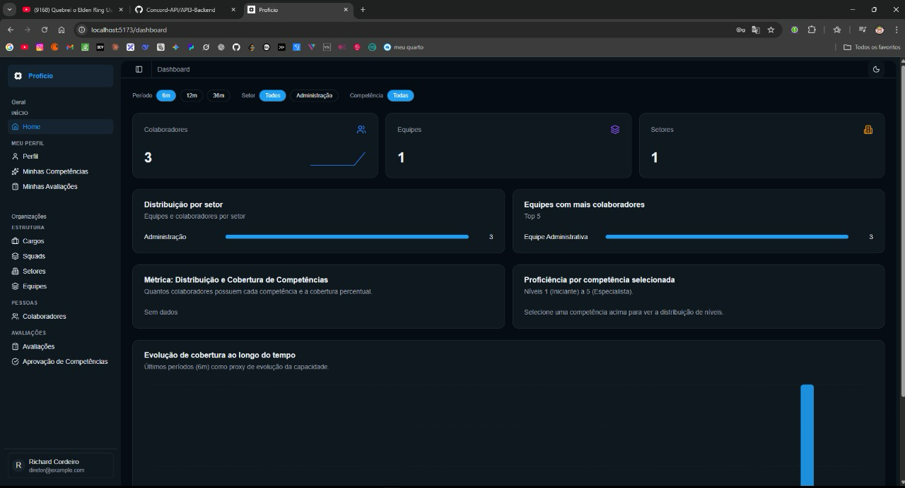

<h2>Sobre mim</h2>


<p align="center"></p>

Meu nome é Richard Leonardo Cordeiro, sou estudante de Banco de Dados na FATEC e atualmente estou no quinto semestre do curso.

Meu primeiro contato com programação aconteceu em 2020, quando comecei a acompanhar conteúdos sobre robótica. Esse interesse abriu caminho para a área de tecnologia e, em dezembro de 2022, iniciei meus estudos de forma mais prática com desenvolvimento web.

Desde então, venho desenvolvendo minhas habilidades em desenvolvimento full stack, com foco em criar soluções que integrem frontend, backend e banco de dados de forma organizada e eficiente.

Atualmente, faço estágio na DNX Soluções, atuando com desenvolvimento full stack utilizando C#. Além disso, estudo e pratico tecnologias como Java e JavaScript, buscando evoluir tanto na construção de interfaces quanto na implementação de regras de negócio e integração com dados.

## Contatos
* [GitHub](https://github.com/RichardCordeiro)
* [LinkedIn](https://www.linkedin.com/in/richardcordeiro/)

## Meus Principais Conhecimentos

**Aplicações e dados**


## Meus Projetos

### Em 2024-2 | API 1º semestre — Calculadora Científica

### Empresa Parceira: FATEC São José dos Campos (projeto interno)

**Papel na equipe:** Scrum Master e desenvolvedor

### Problema:
O primeiro semestre tinha como desafio construir uma solução computacional simples, com foco em algoritmos e lógica de programação. A proposta era reunir, em uma interface de texto parecida com uma calculadora científica, várias operações matemáticas que obrigassem a equipe a aplicar estruturas de decisão, repetição, funções e validação de entrada.

### Solução Entregue pela Equipe:
A equipe desenvolveu uma calculadora científica em Portugol, executada no Visualg, com um menu que permite ao usuário escolher a operação e realizar várias operações na mesma execução. Além das quatro operações básicas, a calculadora resolve fatorial, função de segundo grau, juros simples e compostos, concatenação de strings e conversões entre as bases decimal, binária, octal e hexadecimal. O trabalho foi organizado em três sprints, cada uma com um arquivo de entrega próprio.

[Repositório do Projeto](https://github.com/RichardCordeiro/API-Concord)

#### Principais Funcionalidades

- Menu de escolha das operações, com várias operações por execução.
- Operações básicas: adição, subtração, multiplicação e divisão.
- Cálculo de fatorial e de função de segundo grau.
- Juros simples e juros compostos.
- Concatenação de duas strings.
- Conversão de bases: B10 ↔ B2, B2 ↔ B8 e B2 ↔ B16.

#### Tecnologias Utilizadas

> - **Portugol / Visualg**: Linguagem e ambiente usados para escrever e executar os algoritmos da calculadora.
> - **Git e GitHub**: Utilizados para versionamento, organização das entregas por sprint e colaboração da equipe.

#### Contribuições Pessoais

<details>
  <summary>Scrum Master da equipe</summary>
  <br>
  Atuei como Scrum Master, organizando as sprints, distribuindo as tarefas entre os integrantes e acompanhando o andamento das entregas. Também criei e administrei o repositório do projeto, integrando as funções que cada colega desenvolvia em seu próprio arquivo de sprint.
</details>

<details>
  <summary>Validação e ampliação das conversões de base</summary>
  <br>
  Revisei as funções de conversão de base e incluí em todas a validação de caracteres inválidos, impedindo, por exemplo, que um número binário aceite dígitos diferentes de 0 e 1. Também aumentei a quantidade de dígitos aceita nas conversões de hexadecimal para binário e de binário para hexadecimal.
</details>

<details>
  <summary>Limite do cálculo de fatorial</summary>
  <br>
  Ajustei a função de fatorial para tratar como inválidos os números acima de 12, já que o resultado ultrapassava o limite do tipo inteiro do Visualg e devolvia valores incorretos.
</details>

#### Hard Skills

- **Lógica de programação**: Sei fazer com autonomia
- **Portugol / Visualg**: Sei fazer com autonomia
- **Git/GitHub**: Sei fazer com autonomia

#### Soft Skills

**Liderança**: Como Scrum Master, conduzi a organização das sprints e a divisão das tarefas, mantendo a equipe alinhada em seu primeiro contato com um projeto em grupo.

**Comunicação**: Mantive o diálogo constante com os colegas para integrar as funções desenvolvidas separadamente em uma entrega única.

**Organização**: Estruturei o repositório e as entregas por sprint, o que facilitou o acompanhamento do que cada integrante produziu.

### Em 2025-1 | API 2º semestre — Concord Grid Manager

### Empresa Parceira: FATEC São José dos Campos (projeto interno)

**Papel na equipe:** Desenvolvedor e revisor de código

### Problema:
A montagem da grade de horários de um semestre era feita manualmente. Cada disciplina tem uma quantidade obrigatória de aulas por semana, cada curso posiciona suas aulas de um jeito e o mesmo professor não pode estar em duas aulas no mesmo horário. Sem uma ferramenta própria, o coordenador precisava conferir tudo à mão, o que tornava o processo lento e sujeito a conflitos de horário.

### Solução Entregue pela Equipe:
A equipe desenvolveu o Concord Grid Manager, uma aplicação desktop para gerenciar a grade de horários de aula. O sistema permite cadastrar cursos, disciplinas, professores, turmas e horários, montar a grade da semana, ajustá-la manualmente antes de confirmar e visualizá-la de forma organizada. Ao agendar ou editar uma aula, o sistema verifica automaticamente se o professor já tem outra aula naquele dia e horário e avisa sobre o conflito. O projeto foi entregue em três sprints e incluiu guia de instalação e manual de uso.

[Repositório do Projeto](https://github.com/Concord-API/API-2)

#### Principais Funcionalidades

- Cadastro, edição e exclusão de cursos, disciplinas, professores, turmas e horários.
- Montagem e visualização da grade semanal de aulas.
- Ajustes manuais na grade antes da confirmação.
- Aviso automático de conflito quando um professor é colocado em duas aulas no mesmo horário.
- Gerenciamento do semestre, vinculando disciplinas e horários ao período.

#### Tecnologias Utilizadas

<p align="center">
  <a href="https://skillicons.dev">
    
  </a>
</p>

> - **Java**: Utilizado no desenvolvimento de toda a aplicação.
> - **JavaFX e Scene Builder**: Utilizados na construção das telas da aplicação desktop.
> - **Maven**: Utilizado no gerenciamento de dependências e do build.
> - **MySQL**: Utilizado para armazenar cursos, professores, disciplinas e aulas.
> - **IntelliJ IDEA**: Ambiente de desenvolvimento.
> - **Git e GitHub**: Utilizados para versionamento, colaboração e revisão de código.

#### Contribuições Pessoais

<details>
  <summary>Criação da base do projeto</summary>
  <br>
  Criei o projeto JavaFX com as funcionalidades iniciais, que serviu de base para o restante da equipe. Também desenvolvi views e controllers do sistema, ajustei a lógica de funcionamento das telas e padronizei os nomes exibidos nas telas de curso e de aula.
</details>

<details>
  <summary>Validação de conflito de horário na edição de aulas</summary>
  <br>

```java
public boolean existeConflitoDeHorario(String professor, String dia, String horario, int idAtual) {
    String sql = "SELECT COUNT(*) FROM aulas WHERE professor = ? AND day = ? AND time = ? AND id <> ?";
    try (Connection conn = DriverManager.getConnection(url);
         PreparedStatement stmt = conn.prepareStatement(sql)) {
        stmt.setString(1, professor);
        stmt.setString(2, dia);
        stmt.setString(3, horario);
        stmt.setInt(4, idAtual);
        ResultSet rs = stmt.executeQuery();
        return rs.next() && rs.getInt(1) > 0;
    } catch (SQLException e) {
        e.printStackTrace();
        return false;
    }
}
```

  Implementei a verificação que impede, na edição de uma aula, que o mesmo professor fique com duas aulas no mesmo dia e horário. A consulta ignora a própria aula que está sendo editada (`id <> ?`), e o controller exibe um alerta de conflito em vez de salvar. Também incluí validações de campos obrigatórios e corrigi a versão do JavaFX usada no projeto.
</details>

<details>
  <summary>Banco de dados e integração das sprints</summary>
  <br>
  Fui responsável pelos inserts iniciais do banco de dados, pela remoção do modelo antigo e da base duplicada, e pelos merges das sprints na branch principal, resolvendo os conflitos de integração.
</details>

<details>
  <summary>Revisão de código e apoio à equipe</summary>
  <br>
  Além das minhas tarefas, ajudei os colegas no desenvolvimento das partes deles e revisei os commits da equipe para manter a integridade do código antes de cada integração.
</details>

#### Hard Skills

- **Java**: Sei fazer com autonomia
- **JavaFX**: Sei fazer com autonomia
- **SQL**: Sei fazer com autonomia
- **Git/GitHub**: Sei fazer com autonomia

#### Soft Skills

**Colaboração**: Ajudei os colegas com dificuldades nas próprias tarefas, o que manteve o ritmo da equipe ao longo das sprints.

**Atenção aos detalhes**: Revisei os commits da equipe antes das integrações, evitando que erros e duplicações chegassem à branch principal.

**Autodidatismo**: Aprendi JavaFX e Scene Builder durante o semestre para construir a base do projeto.

### Em 2025-2 | API 3º semestre — Proficio

### Empresa Parceira: [ALTAVE](https://www.altave.com.br/)

**Papel na equipe:** Desenvolvedor e revisor de código

### Problema:
A ALTAVE precisava de uma forma mais eficiente de mapear as competências de seus colaboradores. A empresa tinha dificuldade para alocar profissionais em equipes, squads ou demandas específicas porque não possuía uma visão centralizada das skills técnicas, soft skills, certificações, experiências e níveis de proficiência de cada pessoa.

Sem uma plataforma estruturada para consultar essas informações, a identificação de talentos e a organização de equipes dependiam de processos manuais, o que dificultava a tomada de decisão por parte de diretores e gestores.

### Solução Entregue pela Equipe:
A equipe desenvolveu o Proficio, uma plataforma de mapeamento de competências pensada como um "LinkedIn interno" para a empresa. A solução permite que colaboradores mantenham um perfil profissional com suas habilidades, certificações e informações relevantes, enquanto gestores e diretores conseguem visualizar dados consolidados para apoiar decisões estratégicas.

O sistema conta com controle de acesso por perfil, permitindo que colaboradores acessem suas próprias informações, gestores acompanhem dados de suas equipes e diretores visualizem dashboards, relatórios e métricas gerais. Também foram desenvolvidas funcionalidades para cadastro de usuários, gestores, colaboradores, equipes, setores, skills, avaliações, autoavaliações e filtros por competência.

Com isso, a plataforma facilita a identificação de profissionais com habilidades específicas, apoia a montagem de equipes, melhora a gestão de talentos e oferece uma visão mais clara da distribuição de competências dentro da empresa.


<a href="https://github.com/Concord-API/API-3"></a>

[Repositório do Projeto](https://github.com/Concord-API/API-3) · [Backend](https://github.com/Concord-API/API3-Backend) · [Frontend](https://github.com/Concord-API/API3-Frontend)


#### Principais Funcionalidades

- Dashboard por equipe com visualização de integrantes e distribuição de habilidades.
- Perfil individual para colaboradores com cadastro, edição e exclusão de skills.
- Controle de acesso por perfil para diretor, gestor e colaborador.
- Cadastro e listagem de gestores, colaboradores, equipes e setores.
- Dashboard com métricas de colaboradores, skills, setores e equipes.
- Avaliação de colaboradores e autoavaliação de proficiência.
- Cadastro de skills ainda não registradas no sistema.
- Filtros para busca de colaboradores por competência.

#### Tecnologias Utilizadas

<p align="center">
  <a href="https://skillicons.dev">
    
  </a>
</p>

> - **Java**: Utilizado no desenvolvimento do backend da aplicação.
> - **Spring Boot**: Utilizado para estruturação da API e criação das rotas do sistema.
> - **TypeScript e JavaScript**: Utilizados no desenvolvimento da interface e integrações do frontend.
> - **HTML, CSS e Tailwind CSS**: Utilizados na construção e estilização das telas.
> - **MySQL**: Utilizado para armazenamento e organização dos dados da plataforma.
> - **Docker**: Utilizado para facilitar a configuração e padronização do ambiente.
> - **Git e GitHub**: Utilizados para versionamento, colaboração e revisão de código.
> - **IntelliJ IDEA e VS Code**: Utilizados como ambientes de desenvolvimento.

#### Contribuições Pessoais

<details>
  <summary>Desenvolvimento e estruturação do backend</summary>
  <br>
  Atuei no desenvolvimento de grande parte do backend do projeto, estruturando funcionalidades, adicionando padrões ao código e criando rotas para atender às necessidades da plataforma. Essa atuação envolveu organizar a lógica da aplicação, contribuir para a consistência das entregas e garantir que as funcionalidades estivessem alinhadas aos requisitos definidos nas sprints.
</details>

<details>
  <summary>Revisão de código e padronização do projeto</summary>
  <br>
  Também participei da revisão de código, conferindo implementações, identificando pontos de melhoria e ajudando a manter um padrão mais consistente no projeto. Essa contribuição foi importante para reduzir problemas de integração, melhorar a organização do código e apoiar a equipe durante o desenvolvimento.
</details>

<details>
  <summary>Ajustes no frontend</summary>
  <br>
  No frontend, realizei ajustes básicos de funcionamento para apoiar a integração com o backend e melhorar o comportamento de algumas telas. Minha atuação principal ficou concentrada no backend, mas também contribuí em correções e adaptações pontuais na interface.
</details>

#### Hard Skills

- **Java**: Sei fazer com autonomia
- **Spring Boot**: Sei fazer com autonomia
- **TypeScript**: Sei fazer com autonomia
- **JavaScript**: Sei fazer com autonomia
- **React**: Sei fazer com autonomia
- **HTML**: Sei fazer com autonomia
- **CSS**: Sei fazer com autonomia
- **Tailwind CSS**: Sei fazer com autonomia
- **MySQL**: Sei fazer com autonomia
- **Docker**: Sei fazer com autonomia
- **Git/GitHub**: Sei fazer com autonomia

#### Soft Skills

**Comunicação**: Durante o desenvolvimento do projeto, utilizei uma comunicação clara com a equipe para alinhar decisões técnicas, revisar entregas e ajudar na resolução de conflitos do grupo. Essa postura contribuiu para manter o time mais organizado e focado nas entregas das sprints.

**Colaboração**: Atuei ajudando colegas em dificuldades, principalmente na revisão de código e na organização do backend. Essa colaboração facilitou a integração entre as partes do sistema e ajudou a manter um padrão mais consistente no projeto.

**Autodidatismo**: Ao longo do projeto, tive facilidade para aprender novas abordagens e aplicar esse conhecimento nas demandas da equipe. Busquei entender melhor as tecnologias e padrões utilizados para contribuir tanto no desenvolvimento quanto no apoio aos colegas.
◊


### Em 2026-1 | API 4º semestre — Trivio

### Empresa Parceira: [ALTAVE](https://www.altave.com.br/)

**Papel na equipe:** Desenvolvedor e revisor de código

### Problema:
A ALTAVE precisava gerenciar manutenções de equipamentos distribuídos geograficamente, pertencentes a contratos de diferentes clientes. O planejamento das manutenções periódicas, a alocação de técnicos e o acompanhamento das intervenções dependiam de controles manuais, sem considerar de forma integrada a localização dos equipamentos, a recorrência prevista em contrato, a duração estimada e a prioridade das atividades.

### Solução Entregue pela Equipe:
A equipe desenvolveu o Trivio, uma plataforma web de gerenciamento de manutenções. O sistema permite cadastrar clientes, contratos, equipamentos e técnicos com suas competências, agendar manutenções e acompanhá-las em calendário, lista e mapa. Quando uma manutenção preventiva é concluída, a próxima é gerada automaticamente com base na recorrência do contrato. Os técnicos têm acesso próprio, com sua agenda, o histórico de execuções e notificações das manutenções próximas, e os administradores acompanham o andamento e documentam processos personalizados por contrato. O projeto foi entregue em três sprints, com a aplicação publicada online durante o semestre.

[Repositório do Projeto](https://github.com/Concord-API/API-4) · [Backend](https://github.com/Concord-API/API4-Backend) · [Frontend](https://github.com/Concord-API/API4-Frontend)

#### Principais Funcionalidades

- Cadastro e gerenciamento de clientes, contratos, equipamentos e técnicos.
- Geração automática da próxima manutenção preventiva a partir da recorrência do contrato.
- Calendário de manutenções com arrastar e redimensionar cards.
- Mapa com os locais de atendimento e as manutenções agendadas.
- Área do técnico com agenda, histórico de execução e filtros por dia ou contrato.
- Notificações de manutenções próximas para o técnico.
- Documentação das manutenções e processos personalizados por contrato.

#### Tecnologias Utilizadas

<p align="center">
  <a href="https://skillicons.dev">
    
  </a>
  
</p>

> - **Java e Spring Boot**: Utilizados no backend, com API REST, Spring Security e Spring Data JPA.
> - **Vue.js e TypeScript**: Utilizados no desenvolvimento do frontend.
> - **Oracle Database**: Banco de dados relacional da aplicação.
> - **Swagger / OpenAPI**: Utilizado na documentação dos endpoints da API.
> - **Docker**: Utilizado para padronizar o ambiente e publicar a aplicação.
> - **Git, GitHub e GitHub Projects**: Utilizados para versionamento, revisão de código e gestão das tasks.

#### Contribuições Pessoais

<details>
  <summary>API de manutenções e CRUDs do backend</summary>
  <br>
  Desenvolvi a API de CRUD de manutenções, com as entidades de manutenção, status, tipo e a associação entre manutenção e técnico, além dos DTOs de entrada e saída. Também participei das APIs de clientes e equipamentos, das consultas de manutenções por técnico, da configuração do Swagger e dos ajustes no Spring Security.
</details>

<details>
  <summary>Geração automática da próxima manutenção com o padrão Observer</summary>
  <br>

```java
@Override
public void updateStatus(Maintenance maintenance) {
    if (maintenance.getStatus() != MaintenanceStatus.COMPLETED) return;
    if (Boolean.TRUE.equals(maintenance.getNextGenerated())) return;

    long recorrencia = maintenance.getContract().getRecurrenceMaintenance();

    Maintenance proxima = new Maintenance();
    proxima.setContract(maintenance.getContract());
    proxima.setDate(maintenance.getDate().plusDays(recorrencia));
    proxima.setType(MaintenanceType.PREVENTIVA);
    proxima.setStatus(MaintenanceStatus.SCHEDULED);
    maintenanceRepository.save(proxima);

    maintenance.setNextGenerated(true);
    maintenanceRepository.save(maintenance);
}
```

  Implementei a criação automática da próxima manutenção usando o padrão Observer. O `MaintenancePublisher` notifica os observadores sempre que uma manutenção muda de status, e o `MaintenanceCreatorObserver` agenda a próxima preventiva quando uma manutenção é concluída, somando a recorrência definida no contrato. A flag `nextGenerated` garante que a mesma manutenção não gere duas sucessoras.
</details>

<details>
  <summary>Notificações de manutenções próximas</summary>
  <br>
  Desenvolvi o componente padrão de notificações do sistema de ponta a ponta. No backend, criei um endpoint seguro que devolve ao técnico as manutenções agendadas para os próximos dias, considerando o fuso de São Paulo, com uma consulta JPQL que já traz contrato, cliente e técnicos em uma única ida ao banco. No frontend, criei o sino de notificações que exibe essas manutenções ao técnico.
</details>

<details>
  <summary>Telas do técnico, calendário e mapa</summary>
  <br>
  No frontend, desenvolvi a área do técnico com calendário e visualização em lista das manutenções, o histórico de execução, o mapa com os locais de atendimento e os filtros por dia e contrato em todas as telas de manutenção. Também adicionei o mapa na tela inicial do administrador e o feedback visual em tempo real ao arrastar e redimensionar cards no calendário.
</details>

<details>
  <summary>Padronização do backend e revisão de código</summary>
  <br>
  Padronizei os services e controllers de todas as entidades do backend e revisei os Pull Requests da equipe, conferindo as implementações antes do merge nas branches de sprint.
</details>

#### Hard Skills

- **Java**: Sei fazer com autonomia
- **Spring Boot**: Sei fazer com autonomia
- **Vue.js**: Sei fazer com autonomia
- **TypeScript**: Sei fazer com autonomia
- **Oracle Database**: Sei fazer com autonomia
- **Docker**: Sei fazer com autonomia
- **Git/GitHub**: Sei fazer com autonomia

#### Soft Skills

**Visão de ponta a ponta**: Assumi funcionalidades completas, do banco à tela, como as notificações, o que reduziu a dependência entre backend e frontend nas entregas.

**Colaboração**: Revisei os Pull Requests da equipe e apoiei os colegas na integração das funcionalidades, mantendo um padrão consistente no código.

**Autodidatismo**: Aprendi Vue.js, Oracle e a aplicação prática de padrões de projeto, como o Observer, durante o semestre para atender às demandas do projeto.
